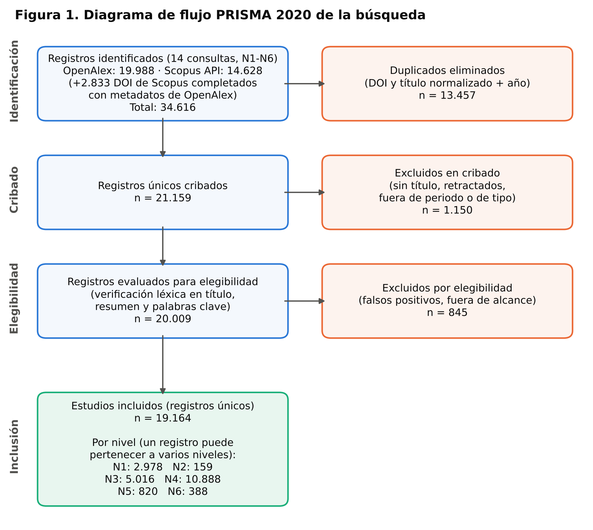
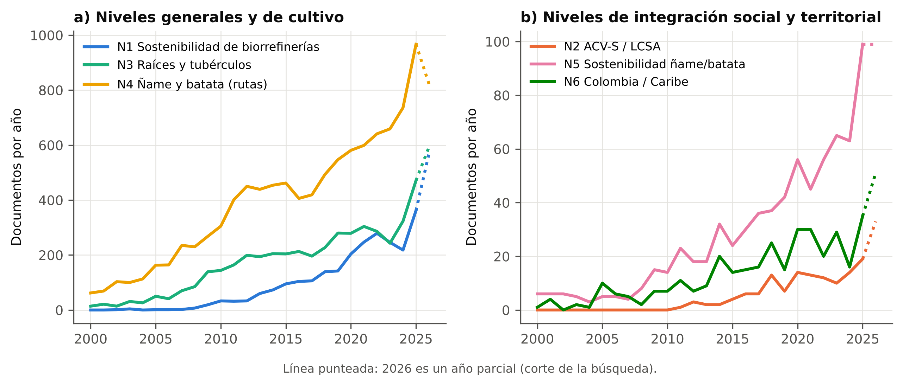
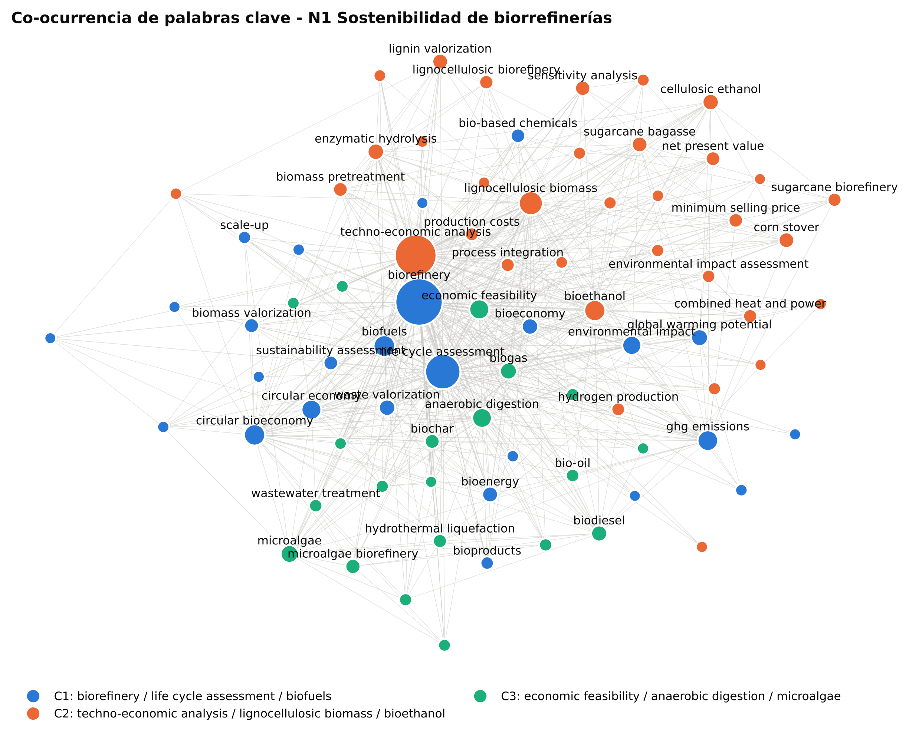
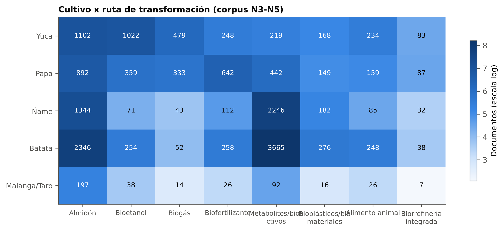
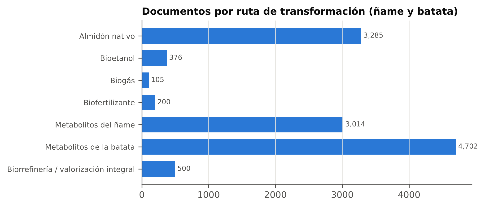
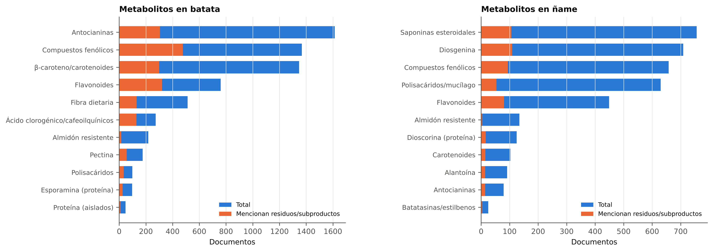
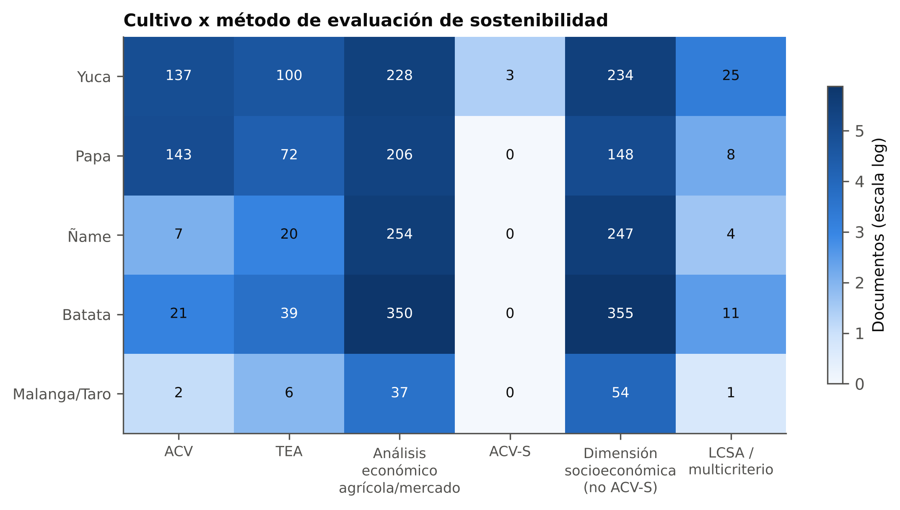
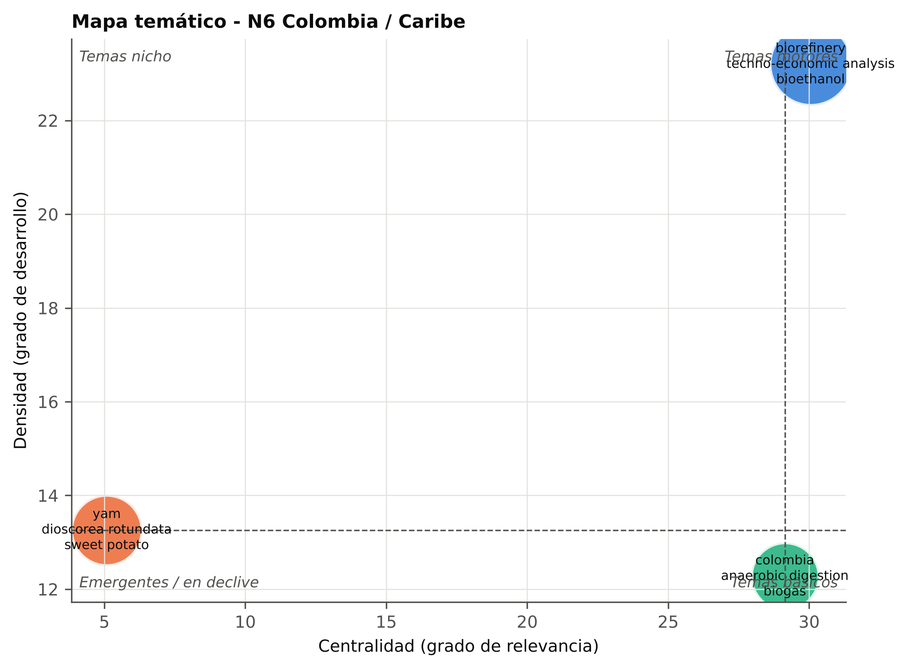

# Resumen

Este trabajo presenta una revisión bibliométrica jerárquica que sustenta el diseño de una biorrefinería integrada a partir de ñame (*Dioscorea rotundata*) y batata (*Ipomoea batatas*) en San Jacinto (Bolívar, Colombia), cuya sostenibilidad se evaluará mediante análisis de ciclo de vida (ACV), evaluación tecno-económica (TEA) y análisis de ciclo de vida social (ACV-S). La literatura se recuperó por consumo programático de las API REST de OpenAlex y Scopus con 14 consultas organizadas en seis niveles, de lo general a lo específico: (N1) sostenibilidad de biorrefinerías, (N2) ACV-S y evaluación de sostenibilidad del ciclo de vida (LCSA), (N3) raíces y tubérculos en bioprocesos, (N4) rutas de transformación del ñame y la batata, (N5) sostenibilidad de sistemas de ñame y batata y (N6) contexto colombiano. De 34.616 registros identificados (2000-2026) se incluyeron 19.347 documentos únicos tras la deduplicación y el cribado automatizado reportado según PRISMA 2020. La evaluación de sostenibilidad de biorrefinerías creció a una tasa anual compuesta del 29,2 % y está dominada por el ACV y el TEA; la dimensión social es marginal (159 documentos). En el corpus de raíces y tubérculos, el ñame y la batata concentran la investigación en almidones y compuestos bioactivos, pero apenas registran 7 y 21 estudios de ACV, 20 y 39 de TEA y ninguno de ACV-S; ningún documento integra los tres pilares para ningún tubérculo, y solo 7 trabajos sobre ñame combinan tres o más de las rutas fijas. Colombia ocupa el noveno lugar mundial en N1 y aporta al autor más productivo del campo, pero su investigación en ñame forma un nicho desconectado de los temas de biorrefinería. El análisis de metabolitos prioriza los compuestos fenólicos y flavonoides (incluidas las antocianinas) para ambos cultivos, por su volumen de evidencia, su vigencia y su obtención a partir de residuos. Estos resultados delimitan un vacío de investigación explícito que justifica la evaluación integrada propuesta.

**Palabras clave:** biorrefinería; análisis de ciclo de vida; evaluación tecno-económica; análisis de ciclo de vida social; ñame; batata; bibliometría; OpenAlex.

# 1. Introducción

La transición hacia una bioeconomía exige sustituir progresivamente las materias primas fósiles por biomasa en la producción de energía, materiales y productos químicos. El concepto de biorrefinería, entendido como el procesamiento sostenible de la biomasa en un espectro de productos comercializables y energía (Cherubini, 2010), se ha consolidado como el marco tecnológico de esa transición. Sin embargo, la viabilidad de una biorrefinería no depende solo de su desempeño técnico: debe demostrar simultáneamente rentabilidad, menor carga ambiental que el sistema de referencia y beneficios para los actores de la cadena de valor (Moncada B. et al., 2016).

Para responder a esa exigencia se dispone de tres herramientas complementarias. El análisis de ciclo de vida (ACV), normalizado en ISO 14040 e ISO 14044 (ISO, 2006a, 2006b), cuantifica los impactos ambientales de un producto a lo largo de su ciclo de vida. La evaluación tecno-económica (TEA) integra el diseño conceptual del proceso, los balances de materia y energía y los indicadores de costo y rentabilidad (Cardona y Sánchez, 2007). El análisis de ciclo de vida social (ACV-S) evalúa los impactos sobre trabajadores, comunidades locales y demás partes interesadas, siguiendo las directrices del Programa de las Naciones Unidas para el Medio Ambiente (UNEP, 2020). La combinación de los tres pilares se conoce como evaluación de sostenibilidad del ciclo de vida (LCSA, por sus siglas en inglés; Kloepffer, 2008).

Las raíces y los tubérculos son materias primas atractivas para biorrefinerías en regiones tropicales: tienen un alto contenido de almidón fermentable, se cultivan en sistemas de pequeña escala y generan residuos (cáscaras, descartes por calibre o daño, follaje) con potencial de valorización. El ñame (*Dioscorea* spp.) es un cultivo central de la economía campesina del Caribe colombiano (Reina-Aranza, 2012), donde la asociatividad de los productores es un determinante de su desempeño (Mendoza-Crespo y Ortiz-Velásquez, 2020). La subregión de Montes de María, a la que pertenece San Jacinto (Bolívar), es además un territorio de posconflicto priorizado por los Programas de Desarrollo con Enfoque Territorial (PDET). Allí, la cadena del ñame depende de un mercado de exportación concentrado y es estructuralmente frágil (Granados Conde et al., 2026). En la región también se cultiva batata, aunque con menor desarrollo agroindustrial. Una biorrefinería que transforme ambas especies en almidón nativo, bioetanol, biogás, biofertilizante y metabolitos de alto valor podría diversificar mercados y aprovechar descartes. Su conveniencia, sin embargo, debe demostrarse con una evaluación integral de sostenibilidad **[VERIFICAR Y COMPLETAR: producción y área de ñame y batata en San Jacinto según Agronet-EVA, último año disponible]**.

Antes de diseñar dicha evaluación es necesario delimitar el estado del conocimiento: qué se ha investigado, quién lo ha hecho, con qué métodos y dónde están los vacíos. Los análisis bibliométricos permiten responder estas preguntas de manera cuantitativa y reproducible sobre grandes volúmenes de literatura (Donthu et al., 2021; Aria y Cuccurullo, 2017). Este trabajo presenta una revisión bibliométrica **jerárquica**, que recorre el campo de lo general a lo específico, desde la evaluación de sostenibilidad de biorrefinerías hasta el contexto colombiano, con seis preguntas de investigación:

- **PI1.** ¿Cómo ha evolucionado la producción científica sobre la evaluación de sostenibilidad de biorrefinerías y quiénes son sus actores principales?
- **PI2.** ¿Qué grado de madurez tiene la integración del ACV-S con el ACV y el TEA?
- **PI3.** ¿Qué rutas de valorización se han estudiado para raíces y tubérculos y cómo se posicionan el ñame y la batata?
- **PI4.** ¿Cuál es el estado de las rutas fijas (almidón nativo, bioetanol, biogás y biofertilizante) para ñame y batata y qué metabolitos son candidatos a completar el portafolio?
- **PI5.** ¿Existen evaluaciones de sostenibilidad de sistemas de ñame y batata y qué brechas presentan?
- **PI6.** ¿Cuál es la producción científica asociada a Colombia y a la región Caribe?

# 2. Metodología

## 2.1 Diseño del estudio y trazabilidad

Se realizó un análisis bibliométrico con dos componentes: análisis de desempeño y mapeo científico (Donthu et al., 2021). El proceso de identificación, cribado y elegibilidad se reporta con el diagrama de flujo de PRISMA 2020 (Page et al., 2021). Todo el procedimiento está implementado como un *pipeline* de código abierto en Python, versionado en un repositorio Git. El repositorio contiene las cadenas de búsqueda, los datos crudos descargados, el registro de cada consulta (fecha, número de resultados y versión del código), los registros excluidos con su motivo, los resultados intermedios y una bitácora de decisiones metodológicas. Así, cada cifra de este artículo puede rastrearse hasta su origen y reproducirse.

## 2.2 Fuentes de datos y técnica de obtención

La recolección se automatizó mediante el **consumo programático de API REST documentadas**, en lugar de técnicas de *web scraping* sobre las interfaces web de bases comerciales. Estas técnicas están restringidas por los términos de uso de los proveedores y no son reproducibles, porque dependen de la estructura HTML y de la sesión.

- **OpenAlex** (fuente principal; Priem et al., 2022). Es un índice bibliográfico abierto que integra metadatos de Crossref, PubMed, ORCID, repositorios y editoriales; su cobertura de referencias es comparable a la de Scopus y Web of Science (Culbert et al., 2025) y sus datos tienen licencia CC0. Se consultó el filtro booleano `title_and_abstract.search` (con *stemming*), restringido a artículos y revisiones de 2000 a 2026. La descarga se hizo por paginación con cursor (lotes de 200 registros), con reintentos y espera exponencial y autenticación mediante clave de API. Para cada nivel se recuperaron además las 60 referencias más citadas localmente.
- **Scopus Search API** (fuente de validación y complemento). Se ejecutaron las cadenas equivalentes en sintaxis TITLE-ABS-KEY. Con la clave disponible, sin token institucional, la API entrega una vista restringida (título, revista, año, citas, DOI y tipo), 25 registros por petición y un máximo de 5.000 resultados por consulta. Por ello, las consultas extensas se dividieron por rangos de años, y los DOI recuperados solo por Scopus se buscaron en OpenAlex para obtener metadatos completos.

La cosecha se ejecutó el 29 de octubre de 2026. Sobre esta fecha de corte, 2026 se trata como un año parcial.

## 2.3 Estrategia de búsqueda jerárquica

La estrategia se organizó en seis niveles anidados (Tabla 1). El nivel N4 se descompuso en siete sub-consultas: las cuatro rutas fijas de la biorrefinería, los metabolitos candidatos de cada cultivo y la valorización integral. Las cadenas completas se encuentran en `config/queries.yaml`.

**Tabla 1.** Niveles de la estrategia de búsqueda y registros recuperados por base de datos.

| Nivel | Alcance | Núcleo de la consulta (título y resumen) | OpenAlex | Scopus | Incluidos* |
|---|---|---|---:|---:|---:|
| N1 | Sostenibilidad de biorrefinerías | biorefinery AND (LCA OR techno-economic OR economic feasibility OR sustainability assessment OR social LCA OR LCSA) | 2.539 | 2.785 | 2.978 |
| N2 | ACV-S / LCSA en sistemas de base biológica | (biorefinery OR bioeconomy OR bio-based OR biofuel OR bioenergy) AND (social LCA OR S-LCA OR LCSA) | 131 | 142 | 159 |
| N3 | Raíces y tubérculos en bioprocesos | (cassava OR yam OR sweet potato OR potato OR taro OR cocoyam OR root/tuber crop) AND (biorefinery OR bioethanol OR biogas OR biofertilizer OR valorization OR LCA OR techno-economic) | 4.704 | 2.912 | 5.016 |
| N4a | Ñame y batata: almidón nativo | (yam OR Dioscorea OR sweet potato OR *Ipomoea batatas*) AND starch AND (extraction OR properties OR yield…) | 3.005 | 2.398 | 3.285 |
| N4b | Bioetanol | … AND (bioethanol OR ethanol production/fermentation OR fuel ethanol) | 346 | 232 | 376 |
| N4c | Biogás | … AND (biogas OR anaerobic digestion OR biomethane OR methane yield) | 101 | 61 | 105 |
| N4d | Biofertilizante | … AND (peel OR residue OR waste OR by-product OR vine) AND (biofertilizer OR compost OR digestate OR biochar…) | 174 | 100 | 200 |
| N4e | Metabolitos del ñame | (yam OR Dioscorea) AND (diosgenin OR dioscorin OR allantoin OR saponin OR phenolic OR flavonoid OR polysaccharide…) | 2.903 | 2.244 | 3.014 |
| N4f | Metabolitos de la batata | (sweet potato) AND (anthocyanin OR chlorogenic acid OR β-carotene OR sporamin OR phenolic OR pectin…) | 4.416 | 2.931 | 4.702 |
| N4g | Valorización integral | … AND (biorefinery OR valorization OR circular economy OR zero waste OR cascade) | 492 | 200 | 500 |
| N5 | Sostenibilidad de ñame y batata | (yam OR Dioscorea OR sweet potato) AND (LCA OR techno-economic OR economic feasibility OR social LCA OR carbon footprint OR value chain…) | 799 | 351 | 820 |
| N6 | Colombia: ñame y batata | (yam OR Dioscorea OR sweet potato OR batata) AND (Colombia OR Montes de María) | 186 | 80 | 179 |
| N6c | Colombia: bioprocesos con raíces y residuos | (biorefinery OR bioethanol OR biogas OR biofertilizer OR LCA OR techno-economic) AND (cassava OR yam OR starch OR agro-industrial residues) AND Colombia | 95 | 89 | 108 |
| N6b | Colombia: biorrefinerías evaluadas | N1 restringido a instituciones colombianas | 97 | 103 | 118 |

\*Registros únicos incluidos tras la fusión de ambas bases, la deduplicación y el cribado.

Durante las pruebas de las consultas se tomaron tres decisiones documentadas en la bitácora del repositorio:

1. El término «ñame» se excluyó de las consultas, porque ambas bases lo normalizan a «name» y recuperaban miles de falsos positivos.
2. En Scopus, el comodín `yam*` se reemplazó por `(yam OR yams)`, porque recuperaba documentos sobre la prueba econométrica de Toda-Yamamoto y el proyecto gasífero Yamal.
3. Las expresiones de evaluación económica se separaron en dos categorías: TEA de procesos y análisis económico agrícola o de mercado.

## 2.4 Depuración y elegibilidad

Los registros de ambas bases se fusionaron y se deduplicaron, primero por DOI y luego por título normalizado más año. Se excluyeron:

- los documentos sin título, los retractados y los que estaban fuera de periodo o de tipo documental;
- los registros de Scopus que no pudieron enlazarse con metadatos completos.

Los falsos positivos se controlaron con una verificación léxica automatizada sobre el título, el resumen y las palabras clave. Por ejemplo, se eliminaron los registros de *yam bean* (*Pachyrhizus*), los de N1 sin mención a biorrefinerías y los de N6 sin vínculo explícito con Colombia. Cuando OpenAlex no distribuía el resumen de un registro (como ocurre con parte de los resúmenes de Elsevier), su coincidencia temática se dio por confirmada si Scopus lo había recuperado con la misma consulta TITLE-ABS-KEY. Cada exclusión quedó registrada con su motivo.

## 2.5 Análisis

- **Desempeño:** producción anual, tasa de crecimiento anual compuesta (TCAC) hasta 2025, citas por documento, índice *h* de cada corpus y colaboración internacional, distinguiendo publicaciones de un solo país (SCP) y multinacionales (MCP).
- **Leyes bibliométricas:**
  - ley de Bradford, para identificar el núcleo de revistas que concentra un tercio de la producción (Bradford, 1934);
  - ley de Lotka, ajustada en escala log-log y contrastada con la prueba de Kolmogorov-Smirnov con α = 0,01 (Lotka, 1926; Pao, 1985).
- **Base intelectual:** referencias más citadas localmente en cada nivel.
- **Mapeo científico:**
  - redes de co-ocurrencia de palabras clave normalizadas con un tesauro, ponderadas por la fuerza de asociación (van Eck y Waltman, 2009) y agrupadas con el algoritmo de Louvain (Blondel et al., 2008);
  - mapas temáticos de centralidad y densidad construidos con el índice de equivalencia (Callon et al., 1991; Cobo et al., 2011);
  - evolución temática en tres periodos: 2000-2015, 2016-2020 y 2021-2026.
- **Análisis de brechas:** el corpus de N3 a N5 se clasificó con diccionarios controlados por cultivo (yuca, papa, ñame, batata, malanga/taro), por ruta de transformación y por método de evaluación. Con esa clasificación se construyeron matrices de cobertura y se midió el grado de integración: documentos con dos o más rutas fijas y con dos o tres pilares de sostenibilidad.
- **Priorización de metabolitos:** se calculó un índice normalizado por cultivo con cuatro componentes:
  - volumen de documentos (peso 0,35);
  - proporción publicada desde 2021 (0,25);
  - proporción que obtiene el metabolito de residuos o subproductos (0,25);
  - proporción con procesos de extracción o recuperación (0,15).

Las redes se exportaron en formato GraphML y el corpus en formato CSV compatible con Scopus, para verificarlos en VOSviewer (van Eck y Waltman, 2010) o biblioshiny (Aria y Cuccurullo, 2017). Las referencias citadas en este artículo se generaron y verificaron a partir de su DOI en la API de Crossref.

# 3. Resultados

## 3.1 Flujo PRISMA y cobertura de las bases de datos

Se identificaron 34.616 registros: 19.988 en OpenAlex y 14.628 en Scopus. Además, 2.833 DOI presentes solo en Scopus se completaron con metadatos de OpenAlex. Tras eliminar 13.457 duplicados quedaron 21.159 registros únicos. En el cribado se excluyeron 1.150 registros: 1.082 de Scopus sin metadatos enlazables, 55 de tipo documental no elegible, 10 retractados, 2 sin título y 1 fuera de periodo. En la verificación de elegibilidad se excluyeron 845 falsos positivos o registros fuera de alcance. El corpus final quedó en **19.347 documentos únicos** (Figura 1).

La comparación de bases justifica el uso combinado. Entre el 91,4 % y el 99,3 % de los DOI recuperados por Scopus existen en el índice de OpenAlex. Sin embargo, la búsqueda en OpenAlex solo recuperó directamente entre el 58,7 % y el 80,0 % de ellos, porque no puede buscar en los resúmenes que no distribuye. A la inversa, OpenAlex aportó registros ausentes en Scopus: por ejemplo, 1.578 en N3 y 1.327 en N4f, en su mayoría revistas regionales y de acceso abierto. La Tabla 2 resume los indicadores de desempeño por nivel.

**Tabla 2.** Indicadores de desempeño por nivel jerárquico.

| Indicador | N1 | N2 | N3 | N4 | N5 | N6 |
|---|---:|---:|---:|---:|---:|---:|
| Documentos | 2.978 | 159 | 5.016 | 10.888 | 820 | 388 |
| Periodo | 2002-2026 | 2011-2026 | 2000-2026 | 2000-2026 | 2000-2026 | 2000-2026 |
| Fuentes | 590 | 71 | 2.035 | 3.384 | 524 | 183 |
| Autores | 10.282 | 589 | 17.679 | 35.374 | 3.095 | 1.039 |
| Revisiones | 300 | 10 | 95 | 241 | 14 | 9 |
| TCAC 2000-2025 (%) | 29,2 | 23,4 | 15,1 | 11,6 | 11,9 | 15,3 |
| Documentos 2021-2026 (%) | 64,5 | 63,5 | 44,3 | 40,6 | 52,1 | 46,6 |
| Citas por documento | 41,1 | 37,0 | 16,3 | 19,6 | 12,4 | 18,3 |
| Índice *h* del corpus | 152 | 44 | 122 | 168 | 47 | 45 |
| Coautores por documento | 5,09 | 4,38 | 4,28 | 4,54 | 4,21 | 4,04 |
| Colaboración internacional (%) | 31,9 | 33,3 | 16,7 | 12,6 | 17,3 | 28,1 |
| Acceso abierto (%) | 55,1 | 64,8 | 60,1 | 54,7 | 70,9 | 65,7 |

En todos los niveles, la productividad de los autores se ajusta a la ley de Lotka según la prueba de Kolmogorov-Smirnov (α = 0,01). Los exponentes (β) varían entre 2,72 (N6) y 3,90 (N5), por encima del valor clásico de 2, lo que indica campos con muchos autores ocasionales: entre el 80,2 % (N1) y el 91,6 % (N5) de los autores firma un solo documento. La dispersión de Bradford es mayor en los niveles de cultivo. En N1, 11 revistas concentran un tercio de la producción (958 documentos), mientras que en N4 se requieren 73.

## 3.2 N1: evaluación de sostenibilidad de biorrefinerías

N1 reúne 2.978 documentos con el mayor crecimiento del estudio (TCAC del 29,2 %). El 64,5 % se publicó desde 2021, con una caída transitoria en 2023-2024 que aparece en ambas bases de datos (Figura 2). El núcleo de Bradford lo encabezan *Bioresource Technology* (167 documentos), *Journal of Cleaner Production* (151), *Biofuels, Bioproducts and Biorefining* (123), *Biomass and Bioenergy* (101) y *Renewable and Sustainable Energy Reviews* (80).

Por países, la producción la lideran Estados Unidos (540 documentos), India (366), China (315), Brasil (233) y España (186). **Colombia ocupa el noveno lugar**, con 108 documentos y 3.761 citas; el 27 % de los documentos que lidera es de colaboración multinacional. El autor más productivo del nivel es Carlos Ariel Cardona Álzate (Universidad Nacional de Colombia), con 66 documentos e índice *h* local de 30. Le siguen J. F. Görgens (Sudáfrica, 52), M. T. Moreira (España, 42), A. Bonomi (Brasil, 36) y J. C. Solarte-Toro (Colombia, 28).

Los documentos más citados combinan revisiones y estudios de caso emblemáticos: la biorrefinería de microalgas (Chew et al., 2017), la biorrefinería de madera con baja huella de carbono (Liao et al., 2020), el ACV de biocombustibles y bioenergía (Cherubini et al., 2009), el TEA de pirólisis rápida (Wright et al., 2010) y las biorrefinerías de residuos en países en desarrollo (Nizami et al., 2017). La base intelectual, es decir, las referencias más citadas por el corpus, la forman el informe de diseño y economía de procesos de etanol lignocelulósico del NREL (Humbird et al., 2011), la base de datos ecoinvent (Wernet et al., 2016), el método ReCiPe 2016 (Huijbregts et al., 2017) y la definición de biorrefinería de Cherubini (2010). En conjunto, describen un campo de **ingeniería de procesos con evaluación ambiental**.

El mapa temático de N1 identifica tres grupos:

- **Tema motor:** ACV, biocombustibles y economía circular (C1).
- **Tema básico o transversal:** TEA de biomasa lignocelulósica para bioetanol (C2).
- **Nicho:** factibilidad económica de digestión anaerobia y microalgas (C3).

La evolución temática muestra un desplazamiento claro. La presencia del TEA pasó del 30,2 % de los documentos en 2000-2015 al 45,0 % en 2021-2026, y la del ACV del 21,9 % al 33,8 %. La bioeconomía circular, ausente antes de 2016, aparece en el 14,0 % de los documentos recientes. En cambio, el etanol celulósico cayó del 11,4 % al 3,1 % y el rastrojo de maíz del 8,0 % al 3,3 %.

## 3.3 N2: integración de la dimensión social

La integración del ACV-S y del marco LCSA en sistemas de base biológica es reciente (desde 2011) y reducida: 159 documentos, frente a 2.978 en N1. Su crecimiento es alto (TCAC del 23,4 %) y la producción es predominantemente europea: Alemania (26 documentos), España (21) e Italia (19). Las fuentes núcleo son *The International Journal of Life Cycle Assessment* (21), *Journal of Cleaner Production* (16) y *Sustainability* (12).

El documento más citado revisa las evaluaciones ambientales, sociales y económicas de los bioplásticos (Spierling et al., 2018). La base intelectual descansa en la Social Hotspot Database (Benoit-Norris et al., 2012), en índices de ACV-S para productos de madera (Siebert et al., 2018), en el ACV-S de biodiésel (Macombe et al., 2013; Manik et al., 2013) y en revisiones de indicadores y marcos (Sala et al., 2013; Kühnen y Hahn, 2017; Lehmann et al., 2013; Ramos Huarachi et al., 2020; Huertas-Valdivia et al., 2020). La aplicación conjunta de LCSA en biorrefinerías se documenta en casos aislados, como el de las macroalgas (Sadhukhan et al., 2019).

El mapa temático ubica a LCSA con toma de decisiones multicriterio, y a ACV con costeo del ciclo de vida, como temas motores. El ACV-S y la sostenibilidad social funcionan como tema básico. La biorrefinería y la bioeconomía circular aparecen como nicho, y la creación de empleo y la salud y seguridad en bioetanol como tema emergente.

## 3.4 N3: raíces y tubérculos como materia prima

N3 reúne 5.016 documentos (TCAC del 15,1 %), con liderazgo de países productores tropicales y emergentes: China (489), Brasil (382), India (347), Nigeria (339) y Tailandia (309). Colombia ocupa el noveno lugar, con 126 documentos. El mapa temático distingue cuatro grupos:

- **Tema motor:** producción de bioetanol con *Saccharomyces cerevisiae* a partir de residuos agrícolas (C1).
- **Tema básico:** digestión anaerobia y biogás de cáscaras de yuca y papa (C2).
- **Nicho:** biofertilizantes en el cultivo de papa (C3).
- **Tema emergente o en declive:** bioetanol de yuca y batata con ACV y gases de efecto invernadero, donde aparece el ñame (C4).

Los trabajos comparativos sitúan a la yuca y la batata entre las fuentes de carbohidratos más productivas para bioetanol (Ziska et al., 2009; Thatoi et al., 2016).

La Tabla 3 cruza cultivos y rutas sobre el corpus de N3 a N5. La yuca es el cultivo con el perfil de rutas más equilibrado (1.102 documentos de almidón, 1.022 de bioetanol y 479 de biogás). El ñame y la batata, en cambio, concentran su literatura en almidón (1.344 y 2.346 documentos) y en metabolitos o bioactivos (2.246 y 3.665). Las rutas energéticas están poco exploradas: el ñame registra 71 documentos de bioetanol y 43 de biogás; la batata, 254 y 52.

**Tabla 3.** Documentos por cultivo y ruta de transformación (corpus N3-N5; un documento puede pertenecer a varias celdas).

| Cultivo | Almidón | Bioetanol | Biogás | Biofertilizante | Metabolitos | Bioplásticos | Alimento animal | Biorrefinería integrada |
|---|---:|---:|---:|---:|---:|---:|---:|---:|
| Yuca | 1.102 | 1.022 | 479 | 248 | 219 | 168 | 234 | 83 |
| Papa | 892 | 359 | 333 | 642 | 442 | 149 | 159 | 87 |
| Ñame | 1.344 | 71 | 43 | 112 | 2.246 | 182 | 85 | 32 |
| Batata | 2.346 | 254 | 52 | 258 | 3.665 | 276 | 248 | 38 |
| Malanga/taro | 197 | 38 | 14 | 26 | 92 | 16 | 26 | 7 |

## 3.5 N4: rutas de transformación del ñame y la batata

N4 es el corpus más grande (10.888 documentos), pero su núcleo de Bradford corresponde a revistas de ciencia de alimentos: *Food Chemistry* (242), *International Journal of Biological Macromolecules* (206), *Starch/Stärke* (132) y *Foods* (125). La producción está dominada por China (2.860 documentos), seguida de Indonesia (991), Nigeria (652), India (620) y Estados Unidos (568). Colombia aparece en el duodécimo lugar (142 documentos), con una tasa de colaboración internacional (30,6 %) superior a la de los líderes.

Las rutas fijas presentan una cobertura muy desigual (Figura 5): almidón nativo, 3.285 documentos; bioetanol, 376; biofertilizante a partir de residuos, 200; biogás, 105. La valorización integral reúne 500.

- **Almidón nativo.** La literatura caracteriza las propiedades fisicoquímicas y funcionales de los almidones de tubérculos tropicales (Moorthy, 2002) y sus aplicaciones en películas biodegradables (Mali et al., 2002) y en empaques inteligentes con antocianinas de batata morada (Choi et al., 2017). Para *D. rotundata* cultivado en Colombia ya existen caracterizaciones de almidones nativos y modificados (Rodríguez‐Manrique et al., 2025). Estos datos son directamente útiles para el inventario del TEA.
- **Bioetanol.** Predominan los estudios de hidrólisis y fermentación de batata (Lareo et al., 2013). Para el ñame la evidencia es escasa y procede, sobre todo, de África occidental y de residuos del procesamiento farmacéutico de *Dioscorea*.
- **Biogás.** Hay estudios de co-digestión de batata con estiércol, con evaluación técnico-económica (Montoro et al., 2019), de digestión de ramas de batata (Zhang et al., 2018) y de pretratamiento de cáscara de ñame (Onu et al., 2022). También se ha tratado por vía anaerobia el efluente de la extracción de diosgenina (Cheng et al., 2009).
- **Biofertilizante.** Es la ruta menos desarrollada como producto de biorrefinería. La literatura se refiere mayoritariamente al efecto de los abonos orgánicos sobre el cultivo (Agbede et al., 2013), no a la transformación de residuos de ñame o batata en un producto fertilizante caracterizado.
- **Valorización integral.** Existen esquemas en cascada para la batata: bioetanol y bebida destilada a partir de residuos (Weber et al., 2020) y extracción secuencial de proteínas y pectinas con uso del residuo sólido en biocompuestos (Vannini et al., 2021). Para el ñame, la obtención combinada de antocianinas y almidón de *D. alata* constituye el antecedente más cercano a una biorrefinería (Ochoa et al., 2023).

El mapa temático de N4 confirma esta orientación:

- **Tema motor:** actividad antioxidante, flavonoides, ñame y diosgenina (C2).
- **Tema básico:** batata, antocianinas y batata de pulpa morada o naranja (C1).
- **Nicho:** almidón de batata y de *D. alata* y sus propiedades funcionales (C3).

Desde 2000, la proporción de documentos sobre actividad antioxidante pasó del 10,3 % al 16,8 %, la de flavonoides del 4,8 % al 9,3 % y la de alimentos funcionales del 2,5 % al 7,1 %. La diosgenina, en cambio, bajó del 7,3 % al 4,1 %.

### Metabolitos candidatos

La minería de metabolitos (Tabla 4, Figura 6) muestra resultados distintos para cada cultivo.

- **Batata.** Los compuestos fenólicos (1.368 documentos; 477 vinculados a residuos), los flavonoides (760) y las antocianinas (1.613 documentos; 601 con procesos de extracción o recuperación) obtienen los índices de priorización más altos. Le siguen los carotenoides (1.347) y el ácido clorogénico, este último con el mayor impacto por documento (34,5 citas) y un 47 % de trabajos basados en hojas, cáscaras u otros residuos.
- **Ñame.** Los flavonoides (índice 0,806), las saponinas esteroidales (0,758), los compuestos fenólicos (0,749) y la diosgenina (0,689) encabezan la priorización. Sin embargo, la evidencia específica en *D. rotundata* es muy distinta según el compuesto: 52 documentos para compuestos fenólicos, 27 para saponinas, 23 para flavonoides y solo 5 para diosgenina. La diosgenina procede sobre todo de especies medicinales como *D. zingiberensis*, *D. bulbifera* y *D. nipponica* (Zhu et al., 2010; Obidiegwu et al., 2020).

**Tabla 4.** Metabolitos con mayor índice de priorización por cultivo.

| Cultivo | Metabolito | Documentos | % desde 2021 | Con residuos o subproductos | Con extracción o recuperación | En *D. rotundata* | Índice |
|---|---|---:|---:|---:|---:|---:|---:|
| Batata | Compuestos fenólicos | 1.368 | 47,7 | 477 | 471 | — | 0,696 |
| Batata | Flavonoides | 760 | 55,3 | 321 | 354 | — | 0,679 |
| Batata | Antocianinas | 1.613 | 44,1 | 306 | 601 | — | 0,637 |
| Batata | β-caroteno/carotenoides | 1.347 | 44,0 | 299 | 190 | — | 0,544 |
| Batata | Ácido clorogénico | 273 | 35,5 | 129 | 122 | — | 0,479 |
| Ñame | Flavonoides | 449 | 55,9 | 80 | 251 | 23 | 0,806 |
| Ñame | Saponinas esteroidales | 756 | 35,6 | 106 | 419 | 27 | 0,758 |
| Ñame | Compuestos fenólicos | 658 | 46,5 | 94 | 295 | 52 | 0,749 |
| Ñame | Diosgenina | 709 | 30,2 | 109 | 321 | 5 | 0,689 |
| Ñame | Polisacáridos/mucílago | 630 | 39,5 | 54 | 257 | 10 | 0,581 |
| Ñame | Dioscorina (proteína) | 125 | 24,0 | 16 | 54 | 3 | 0,320 |

## 3.6 N5: evaluaciones de sostenibilidad del ñame y la batata

N5 reúne 820 documentos, con un perfil de impacto bajo (12,4 citas por documento) y liderado por Nigeria (137 documentos), India (62) e Indonesia (57). Su mapa temático muestra que la «sostenibilidad» del ñame y la batata se ha abordado sobre todo desde la economía agrícola. Son temas motores la rentabilidad de pequeños productores, los márgenes brutos y la seguridad alimentaria; el análisis beneficio-costo de sistemas de cultivo es transversal, y la factibilidad económica con valor presente neto es un nicho asociado a Nigeria.

La Tabla 5 cuantifica la brecha metodológica.

**Tabla 5.** Documentos por cultivo y método de evaluación, y grado de integración (corpus N3-N5).

| Cultivo | Documentos | ACV | TEA | Análisis económico agrícola o de mercado | ACV-S | Dimensión socioeconómica sin ACV-S | LCSA/multicriterio | ≥ 2 rutas fijas | ≥ 3 rutas fijas | ACV + TEA | ACV + TEA + ACV-S |
|---|---:|---:|---:|---:|---:|---:|---:|---:|---:|---:|---:|
| Yuca | 2.828 | 137 | 100 | 228 | 3 | 234 | 25 | 673 | 57 | 24 | 0 |
| Papa | 2.781 | 143 | 72 | 206 | 0 | 148 | 8 | 479 | 31 | 8 | 0 |
| Ñame | 4.378 | 7 | 20 | 254 | 0 | 247 | 4 | 353 | 7 | 0 | 0 |
| Batata | 7.153 | 21 | 39 | 350 | 0 | 355 | 11 | 692 | 15 | 1 | 0 |
| Malanga/taro | 398 | 2 | 6 | 37 | 0 | 54 | 1 | 57 | 1 | 0 | 0 |

Los ACV identificados para la batata se centran en el bioetanol. Uno se realizó en una planta experimental (Costa et al., 2018) y otro comparó tres modos de producción, con la mejor eficiencia energética para el modo de economía circular (Zhang et al., 2017); un tercer trabajo evaluó el consumo energético del proceso (Ferrari et al., 2013). El único estudio que combina TEA y ACV para tubérculos amiláceos encontró que la batata tiene una alta rentabilidad inicial (retorno de la inversión del 41,96 %), pero un potencial de calentamiento global de 2,53 kg CO₂-eq frente a 0,25 kg CO₂-eq de la yuca, en una planta de 158.000 m³/año (Sanni et al., 2022).

Para el ñame, los TEA disponibles se concentran en la extracción de metabolitos de *D. alata* en Colombia. Ochoa et al. (2020) evaluaron la extracción de antocianinas asistida por ultrasonido y Ochoa et al. (2023) la integraron con la recuperación de almidón. Quiñonez-Ensuncho et al. (2026) mostraron que el almidón residual de esa extracción puede hidrolizarse a jarabe de glucosa, con factibilidad económica si se adquiere por menos de 1,20 USD/kg. Para la batata, Mokhtar (2022) simuló cinco escenarios de transformación de una variedad de pulpa naranja en productos de valor agregado con SuperPro Designer.

**No se identificó ningún estudio de ACV-S, ni ninguna evaluación que integre ACV, TEA y ACV-S, para ningún tubérculo.**

## 3.7 N6: contexto colombiano

N6 reúne 388 documentos, con crecimiento reciente (51 documentos en 2026, año parcial). Las instituciones colombianas más productivas son la Universidad Nacional de Colombia (122 documentos), la Universidad de Sucre (28), la Universidad de Cartagena (27), AGROSAVIA (23) y la Universidad de Córdoba. Por cultivo, el ñame (117 documentos) supera a la batata (64) y a la yuca (44). Por ruta, predominan la biorrefinería integrada (141), el biogás (63), el almidón (56) y el bioetanol (54). Por método, el TEA (107) supera al ACV (73), y el ACV-S apenas registra 6 documentos.

La capacidad colombiana en diseño y TEA de biorrefinerías es reconocida internacionalmente. Destacan el TEA de la biorrefinería de caña para el caso colombiano (Moncada et al., 2013), el etanol a partir de caña y maíz (Quintero et al., 2008), el TEA y la evaluación ambiental del etanol a partir de diez residuos agroindustriales (Duque et al., 2015), la revisión de la lignina como plataforma (Poveda-Giraldo et al., 2021) y la biorrefinería de malanga (*Xanthosoma sagittifolium*) orientada a la seguridad alimentaria (Serna-Loaiza et al., 2018). Para el almidón de yuca se comparó la huella de carbono, el uso de agua y el de energía entre Tailandia, Vietnam y Colombia (Tran et al., 2015).

El trabajo más cercano al objeto de esta tesis compara la producción de bioetanol a partir de caña, yuca y ñame en Colombia mediante simulación en Aspen Plus (Villadiego-del Villar et al., 2026). El ñame alcanzó un costo de producción de 1,11 USD/L, frente a 2,28 USD/L de la yuca y 0,68 USD/L de la caña. También mostró el mayor potencial de cogeneración eléctrica (171.330 kWh), pero su valor presente neto fue negativo en el escenario de producto único.

El mapa temático de N6 revela una desconexión (Figura 8). Los temas de biorrefinería, TEA y ACV forman un grupo motor, y la digestión anaerobia de residuos agroindustriales un grupo básico. En cambio, la investigación colombiana sobre ñame (*D. rotundata*, *D. alata*, Montes de María, diversidad genética, antracnosis por *Colletotrichum*, seguridad alimentaria) forma un **nicho de alta densidad interna y baja centralidad**: es un tema bien desarrollado, pero aislado de los temas de biorrefinería. Los estudios recientes del Caribe abordan la cadena del ñame desde la fragilidad estructural (Granados Conde et al., 2026), la optimización logística con pérdidas superiores al 30 % en Sucre (Vergara Rodríguez et al., 2025) y la transformación agroindustrial a escala rural (Martín et al., 2026; Paternina et al., 2026). En batata, los trabajos colombianos se orientan a la conservación de germoplasma (Rosero et al., 2022) y a la bioprospección de metabolitos de variedades nativas (CHÁVEZ et al., 2026).

# 4. Discusión

## 4.1 Madurez desigual de los tres pilares de sostenibilidad

El embudo bibliométrico confirma que la evaluación de sostenibilidad de biorrefinerías es un campo maduro y en expansión acelerada, con un núcleo de revistas de ingeniería y un corpus metodológico consolidado: diseño de procesos al estilo NREL, ecoinvent y ReCiPe. Ese desarrollo, sin embargo, es asimétrico. El TEA y el ACV dominan y crecen, mientras que la dimensión social apenas reúne 159 documentos en todo el espectro de sistemas de base biológica. Además, el ACV-S está geográficamente concentrado en Europa y aplicado sobre todo a madera, biodiésel y bioplásticos. Los pocos casos tropicales, como la palma de aceite (Manik et al., 2013), muestran que las categorías de impacto social dependen fuertemente del contexto, lo que refuerza la necesidad de datos primarios regionales.

Para la tesis, esto implica que la evaluación social no podrá apoyarse en estudios análogos de tubérculos. Deberá construirse con las directrices de UNEP (2020) y bases de *hotspots* sociales (Benoit-Norris et al., 2012), adaptando sus indicadores a las categorías de trabajadores, comunidad local y agricultores definidas en los objetivos.

## 4.2 Ñame y batata: abundante ciencia de alimentos, escasa ingeniería de biorrefinerías

El volumen de literatura sobre ñame y batata (10.888 documentos en N4) contrasta con su escasa presencia como materia prima de bioprocesos evaluados. La comparación con la yuca es ilustrativa: la yuca tiene 137 ACV, 100 TEA y 24 estudios que combinan ambos, mientras que el ñame tiene 7 ACV, 20 TEA y ninguno combinado. La integración de rutas es igualmente baja: solo 7 documentos sobre ñame y 15 sobre batata combinan tres o más de las rutas fijas.

La evidencia económica disponible sugiere por qué la integración es necesaria. En Colombia, el bioetanol de ñame como producto único tiene costos competitivos frente a la yuca, pero un valor presente neto negativo (Villadiego-del Villar et al., 2026). En la batata, la rentabilidad del bioetanol se acompaña de una carga climática diez veces superior a la de la yuca (Sanni et al., 2022). Ambos resultados apuntan a que la viabilidad depende de distribuir costos e impactos entre varios productos, que es precisamente la lógica de la biorrefinería integrada.

## 4.3 Implicaciones para el diseño conceptual (TEA)

La literatura permite proponer una configuración en cascada coherente con las rutas fijas:

1. Extracción del metabolito de alto valor a partir del tubérculo de descarte o de la cáscara.
2. Recuperación de almidón nativo del residuo de extracción. Ochoa et al. (2023) y Quiñonez-Ensuncho et al. (2026) mostraron que el almidón residual conserva su valor.
3. Hidrólisis y fermentación del almidón no comercializable y de los descartes a bioetanol.
4. Digestión anaerobia de vinazas, cáscaras y ramas para obtener biogás y cogenerar energía (Montoro et al., 2019; Onu et al., 2022; Zhang et al., 2018).
5. Acondicionamiento del digestato como biofertilizante.

La ruta del biofertilizante es la menos documentada como producto: la tesis deberá caracterizar el digestato y el compost (nutrientes, estabilidad, inocuidad), en lugar de asumir su valor comercial. Del mismo modo, como el ñame carece de casi todo ACV, el inventario de ciclo de vida exige datos primarios de San Jacinto (rendimientos, fertilización, transporte y pérdidas poscosecha).

## 4.4 Selección de los metabolitos

La priorización ofrece un criterio cuantitativo para los metabolitos «por definir», que deberá confirmarse con la caracterización del material vegetal local:

- **Batata.** Los compuestos fenólicos y, dentro de ellos, las antocianinas y el ácido clorogénico combinan el mayor volumen de evidencia, una alta proporción de estudios con extracción desde residuos y aplicaciones industriales demostradas, como colorantes, empaques inteligentes y antioxidantes (Teow et al., 2007; Choi et al., 2017; Alam, 2021). La elección entre antocianinas y carotenoides depende de la variedad que se cultive en San Jacinto: las antocianinas son pertinentes para batata de pulpa morada y el β-caroteno para variedades de pulpa naranja, como Agrosavia Aurora. El ácido clorogénico es una alternativa que permite valorizar hojas y ramas, un residuo voluminoso del cultivo (Sun et al., 2014). La fibra y la pectina del residuo de extracción de almidón (Mei et al., 2010) y las proteínas o péptidos recuperables (Zhang et al., 2014) son coproductos secundarios.
- **Ñame.** Aunque la diosgenina y las saponinas esteroidales dominan la literatura del género, su evidencia en *D. rotundata* es mínima (5 documentos) y procede de especies medicinales con contenidos mucho mayores. Por ello, para el ñame de San Jacinto se recomienda priorizar el **extracto fenólico o de flavonoides** a partir de cáscaras, que es el grupo con más evidencia específica en *D. rotundata* (52 documentos) y una tendencia creciente (Adomėnienė y Venskutonis, 2022). Como segunda opción, los **polisacáridos no amiláceos o mucílago** de la cáscara, con propiedades funcionales documentadas (Zhao et al., 2023). La dioscorina (Hou et al., 2001) y la alantoína (Fu et al., 2006) son alternativas de alto valor, pero con evidencia insuficiente para un diseño conceptual sin experimentación previa.

## 4.5 Implicaciones para el ACV-S y el contexto territorial

El análisis de N6 muestra que Colombia cuenta con una escuela consolidada de diseño y evaluación de biorrefinerías (Moncada B. et al., 2016; Poveda-Giraldo et al., 2021) y con grupos regionales que estudian el ñame del Caribe desde la agronomía, la poscosecha y la cadena de suministro. Ambas comunidades, sin embargo, no se han encontrado. Una evaluación integrada en San Jacinto conecta esos dos nichos y aborda problemas sociales documentados en la región: la fragilidad de la cadena exportadora (Granados Conde et al., 2026), las pérdidas logísticas (Vergara Rodríguez et al., 2025) y la importancia de la asociatividad productiva (Mendoza-Crespo y Ortiz-Velásquez, 2020). Estos problemas sugieren subcategorías prioritarias para el ACV-S: ingresos justos y estabilidad de precios para agricultores, empleo local y condiciones de trabajo en la planta, acceso a recursos materiales e infraestructura comunitaria, y seguridad alimentaria.

## 4.6 Limitaciones

1. La búsqueda en título y resumen no recupera los documentos que tratan el tema solo en el texto completo, y parte de los resúmenes no está disponible en OpenAlex. La fusión con Scopus mitigó esta limitación (entre el 91,4 % y el 99,3 % de los DOI de Scopus se enlazaron), pero no la elimina.
2. La API de Scopus se usó en su vista restringida, por lo que los registros de Scopus no enlazables (1.082) no aportan autores ni afiliaciones.
3. La clasificación por diccionarios y las palabras clave de OpenAlex, asignadas automáticamente, introducen ruido. En N5 persisten documentos donde el cultivo se menciona de forma incidental. Esos documentos no se excluyeron manualmente, para preservar la reproducibilidad, y no se usaron en la interpretación cualitativa.
4. La literatura gris (informes de AGROSAVIA, MADR, ICA y tesis) no forma parte del análisis bibliométrico.
5. 2026 es un año parcial, por lo que las tasas de crecimiento se calcularon hasta 2025.

# 5. Conclusiones

1. La evaluación de sostenibilidad de biorrefinerías crece a una tasa anual compuesta del 29,2 % y se estructura alrededor del ACV y el TEA de biomasa lignocelulósica, con un giro reciente hacia la bioeconomía circular. Colombia es un actor relevante del campo: ocupa el noveno lugar mundial y aporta al autor más productivo.
2. La dimensión social es el pilar menos desarrollado (159 documentos sobre ACV-S o LCSA en sistemas de base biológica), con aplicaciones concentradas en Europa y en materias primas no amiláceas.
3. Entre las raíces y los tubérculos, la yuca concentra la investigación sobre rutas energéticas y evaluación de sostenibilidad. El ñame y la batata concentran su literatura en almidón y compuestos bioactivos, con muy pocos ACV (7 y 21) y TEA (20 y 39), y sin ningún ACV-S.
4. No existe en la literatura indexada ninguna evaluación que integre ACV, TEA y ACV-S para biorrefinerías de tubérculos. Solo 7 documentos sobre ñame y 15 sobre batata combinan tres o más de las rutas fijas. Este es el vacío de investigación que aborda la tesis.
5. La evidencia bibliométrica respalda una configuración en cascada (metabolito → almidón → bioetanol → biogás → biofertilizante). Como metabolitos se priorizan los compuestos fenólicos o flavonoides de la cáscara para el ñame y las antocianinas, el ácido clorogénico o el β-caroteno (según la variedad) para la batata. La selección final requiere caracterizar la biomasa de San Jacinto.
6. En Colombia, la investigación en biorrefinerías y la investigación en ñame forman comunidades desconectadas. Integrarlas en un caso territorial de Montes de María aporta novedad científica y pertinencia social.

**Trabajo futuro:** actualizar periódicamente la búsqueda ejecutando de nuevo el *pipeline*, incorporar las exportaciones completas de Scopus o Web of Science si se dispone de acceso institucional, y complementar el análisis bibliométrico con una revisión sistemática cualitativa de los estudios clave identificados (`results/tables/estudios_clave.csv`).

# Disponibilidad de datos y código

El código, las cadenas de búsqueda, los datos crudos (OpenAlex y Scopus), el corpus depurado, los registros excluidos con su motivo, las redes (GraphML), las tablas, las figuras y la bitácora de decisiones metodológicas están disponibles en el repositorio GitHub del proyecto (`EstebanCastilla/Revision-bibliometrica`). Para reproducir el análisis: `python src/01_harvest_openalex.py`, `python src/02_harvest_scopus_api.py` y `bash run_analysis.sh`.

# Referencias

<!-- REFERENCIAS -->
